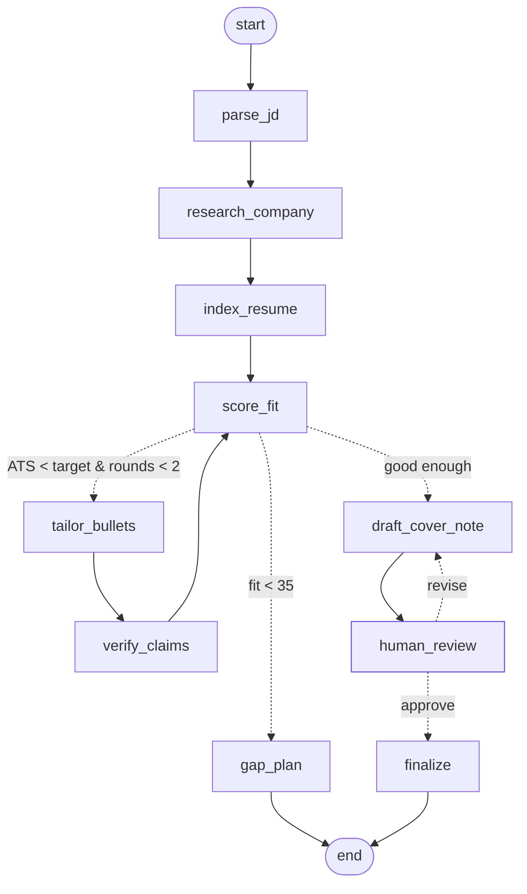

# JobPilot — a LangGraph agent that tailors job applications honestly

[](https://github.com/NiKeT972/jobpilot/actions/workflows/tests.yml)

Paste a job description and your resume. JobPilot parses the JD, researches the company with a tool call, retrieves evidence from your resume (RAG), scores your fit, rewrites bullets to use the JD's language in a loop, **checks every rewrite against your original resume so it never invents experience**, drafts a cover note, and pauses for your approval before building the final package: tailored bullets, cover note and likely interview questions.

**Live demo:** https://jobpilot-agent-nine.vercel.app

## The agent graph



| Node | Type | What it does |
|---|---|---|
| `parse_jd` | LLM structured output | JD → Pydantic `JobSpec` (title, must-have / nice-to-have skills, responsibilities, years) |
| `research_company` | **LangChain tool** | `@tool company_research`: Tavily web search if a key is set, otherwise the Wikipedia API |
| `index_resume` | **RAG** | Splits the resume into bullets and uses a custom LangChain `BaseRetriever` (BM25 + skill-synonym query expansion) to find evidence for every JD skill |
| `score_fit` | Rules + LLM | Two scores: **real fit** (synonym-aware: "GPT-4" counts as LLMs) and **ATS keyword match** (the JD's exact words) |
| `tailor_bullets` | LLM | Rewrites evidenced bullets to use the JD's exact terms, keeping every fact |
| `verify_claims` | Rules | Honesty check: reverts any rewrite that adds a skill, number, seniority/impact claim or name not in the original bullet (measured: see below) |
| `gap_plan` | Rules | Early exit for poor matches, with a concrete plan to close the gaps |
| `draft_cover_note` | LLM | Specific cover note grounded in your bullets and the company research |
| `human_review` | **Human-in-the-loop** | `interrupt_before`: you approve or ask for changes, which loop back into the draft |
| `finalize` | LLM | Final package plus interview questions aimed at your gaps |

## Features

- **Upload your resume** as PDF, DOCX or TXT (`/api/resume-file`, in memory only). PDF text is cleaned up so each bullet ends up on one line, even when the PDF wrapped it.
- **Download the approved package** (cover note, tailored bullets, interview prep) as a Word file (`/api/package.docx`).
- **Measured honesty check:** `python scripts/eval_honesty.py` runs `verify_claims` over 28 hand-labelled rewrites (`evals/honesty_cases.jsonl`) and prints recall, precision and every mistake. CI fails if recall drops below 100% or precision below 90%.

## Evaluating the honesty check

| | First version | Now |
|---|---|---|
| Invented claims caught (recall) | 12/16 (75%) | 16/16 (100%) |
| Reverts that were correct (precision) | 12/14 (86%) | 16/17 (94%) |

The first version only looked for new skills and numbers, so "…at Google", "Led a team…", "…to all customers" and "Award-winning…" got through, and it wrongly blocked "(Machine Learning)" on a scikit-learn/XGBoost bullet. It now also rejects new claim words (led, team, production, customers, award…) and new names, and allows an umbrella JD term when a more specific skill implies it (`skills.IMPLIED_BY`). Caveat: the cases were written by the author and the fixes target the misses they exposed, so treat 100% as "no known misses", not a guarantee.

## End-to-end evaluation

`python scripts/eval.py` runs the whole agent (rules mode with `--rules`, the LLM if `GROQ_API_KEY` is set) on `evals/fit_cases.json`: **8 job descriptions × 4 fictional resumes = 18 pairs** (AI engineer, data analyst, ML engineer, senior data engineer, full-stack, BI analyst, NLP engineer and DevOps JDs; a GenAI grad, a business analyst, a web developer and a data engineer). Before running the agent, I labelled each JD's must-have skills, each resume's real skills, and whether a careful recruiter would tell that candidate to apply. Results go to `evals/report_<mode>.json`, `GET /api/eval` and the app's **Evaluation** panel.

**Task success:** for a good match, the agent recommends applying, the approved package is built, the tailored resume contains no skill the original didn't have, the ATS score doesn't drop and the cover note names the role and company. For a poor match, it stops early with a gap plan.

| Metric (rules mode, no LLM) | First run | Now |
|---|---|---|
| Task success (end to end) | 77.8% | 94.4% |
| Right apply / don't-apply advice | 77.8% | 94.4% |
| Good matches told to apply | 100.0% | 100.0% |
| Poor matches stopped with a gap plan | 63.6% | 90.9% |
| JD must-haves found | 95.2% | 100.0% |
| Found must-haves that are real | 90.9% | 100.0% |
| Candidate's real skills credited | 95.3% | 100.0% |
| Credited skills that are real | 91.0% | 98.5% |
| Invented skills in final resumes | 0 | 0 |
| Average ATS lift (points) | 14.3 | 16.6 |

What the first run found, and the general fixes:
- **It told 4 of 11 poor matches to apply.** Partial credit was given for any skill in the same "family", so knowing Python counted as half of Go and Java, and Docker as half of Kubernetes and Terraform. Partial credit is now limited to families where a skill really transfers (PyTorch ↔ TensorFlow, Power BI ↔ Tableau, Azure ↔ AWS, LangChain ↔ LangGraph…).
- **Docker and Git were dropped from the AI Engineer JD** by a hard cap of 12 must-haves, applied in lexicon order rather than JD order. When a JD has a *Requirements / Must have / Key skills* list, that list is now the must-haves. Skills mentioned only in the title or "what you'll do" become nice-to-haves, so a "Machine Learning Engineer" title no longer makes ML a must-have.
- **"GitHub Actions" counted as both CI/CD and Git.** A skill found inside a longer match for another skill no longer counts. "Presenting insights" now counts as communication.

The fixes don't change the honesty check's results (`scripts/eval_honesty.py` gives the same numbers before and after).

**Held-out check.** The fixes were made against these 18 pairs, so "Now" is optimistic. Afterwards I wrote 6 more pairs (2 new JDs and a statistics-graduate resume, in the `holdout` block) and ran them once without tuning: **100.0% task success, 0 invented skills**. The one miss left in the main set is a web developer's "billing dashboard" being read as data-visualisation experience for a BI role: a real ambiguity in the skill lexicon, left as is.

`test_end_to_end_eval_does_not_regress` fails CI if any package contains an invented skill, a good match isn't recommended, or task success drops below 90%.

## Tracing with LangSmith

Set `LANGSMITH_TRACING=true` and `LANGSMITH_API_KEY` (optionally `LANGSMITH_PROJECT=jobpilot`) to send every graph run, node, tool call and LLM call to LangSmith. LangChain and LangGraph read these variables themselves. Runs are named `start` / `resume` and tagged with the company, ATS target and your decision, so you can filter traces. `/api/health` shows `tracing: true` when it's on; tests force it off.

## Why two scores?

Most "resume optimisers" push a single match score up by stuffing keywords, which is how candidates end up claiming tools they've never used. JobPilot separates the two:

- **Real fit** is fixed by what's actually in your resume. Tailoring cannot change it.
- **ATS match** measures whether keyword filters will see your experience. Tailoring raises it honestly, because `verify_claims` only allows a JD term onto a bullet that already shows that skill (e.g. "Azure OpenAI" → "Azure OpenAI (LLMs)").

## Engineering notes

- **Loops with a hard stop:** `score_fit → tailor_bullets → verify_claims → score_fit` runs at most 2 rounds and stops early when nothing more can be tailored honestly.
- **Stateless human-in-the-loop on serverless:** the paused state goes back to the browser; on resume the API rebuilds the graph and calls `update_state(..., as_node="draft_cover_note")`, so LangGraph continues from the interrupt.
- **Tamper-proof paused state:** because the state round-trips through the browser, a user could otherwise edit it (e.g. slip in a bullet that never passed the honesty check). The API returns the paused state inside an HMAC-SHA256-signed token (`jobpilot/state_token.py`) and resumes only from a token it signed; edited tokens get a 400. Set `STATE_SIGNING_KEY` in production.
- **Graceful degradation:** every LLM node has a deterministic fallback, so the demo works with no API keys; the UI tags each step as LLM, tool, rules or human.
- **Tests:** every graph path, the honesty checker, skill matching, the LLM paths (with a stub model) and the end-to-end eval thresholds: `pytest -q`.

## Stack

LangGraph 1.x · LangChain Core (tools, retrievers, structured output) · langchain-groq (gpt-oss-120b by default, set with `GROQ_MODEL`) · rank-bm25 · httpx · FastAPI · vanilla JS · Vercel

## Run locally

```bash
python -m venv .venv && source .venv/bin/activate   # Windows: .venv\Scripts\activate
pip install -r requirements-dev.txt                 # app deps + pytest + uvicorn
cp .env.example .env                                # then put your GROQ_API_KEY in .env (optional)
uvicorn app:app --reload
pytest -q
python scripts/live_check.py                        # with the server running: both samples, every review path
```

Keys are read from `.env` via python-dotenv (`GROQ_API_KEY`, optional `TAVILY_API_KEY` for better company research). Real environment variables take precedence, which is how Vercel supplies them.

---
Built by **Niket Korgaonkar** · [GitHub](https://github.com/NiKeT972)
